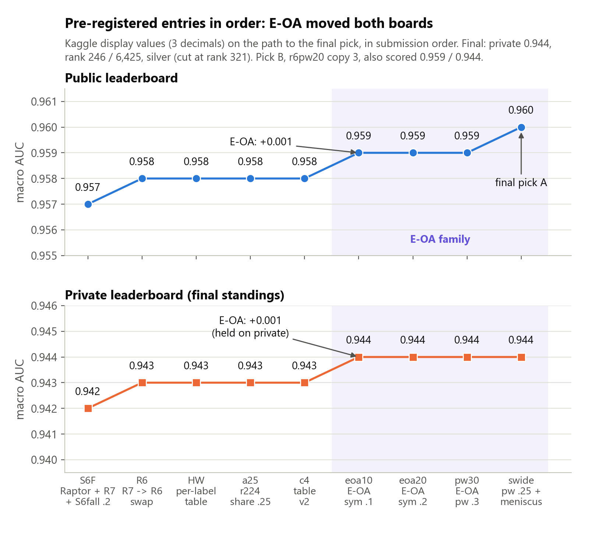
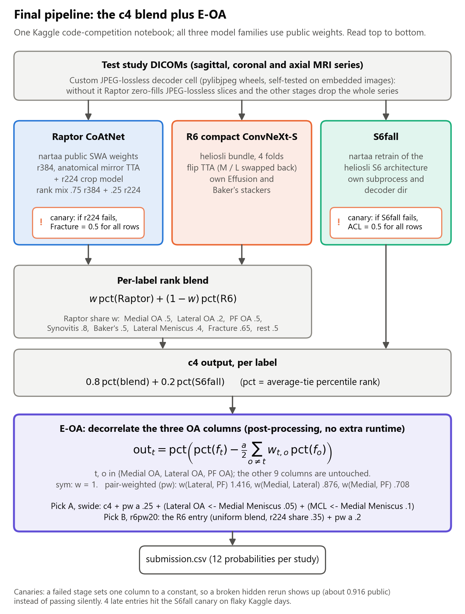
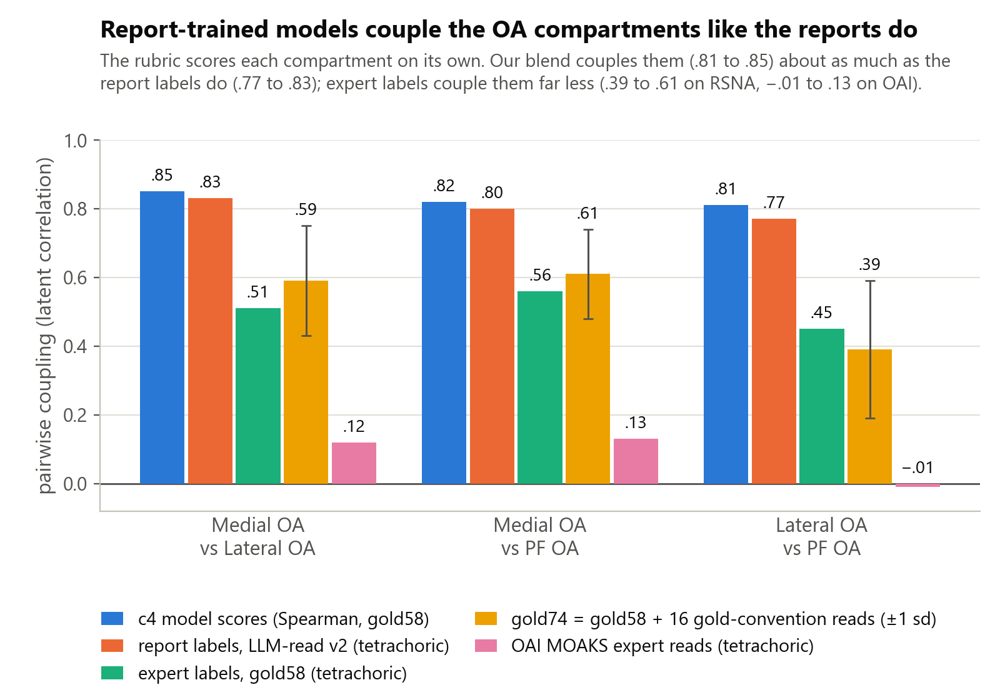
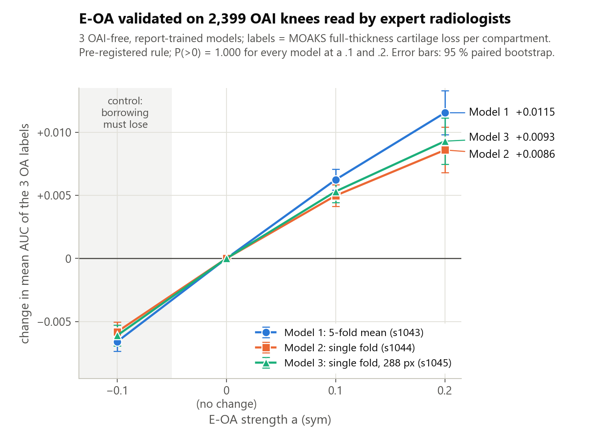
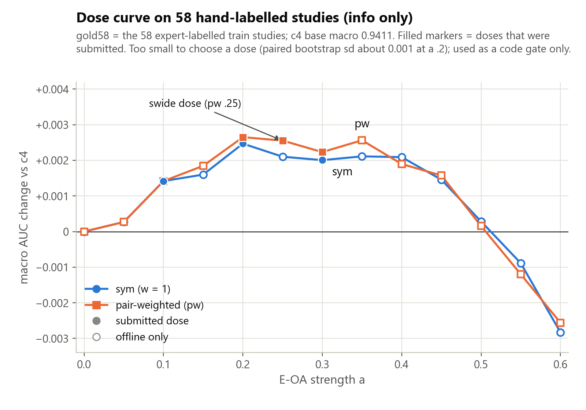

# RSNA Knee Abnormality Detection (Kaggle, 2026): Project Summary

**Private rank 246 / 6,425 · private macro AUC .944 · silver medal**

We built a public-weights ensemble for 12-label knee MRI classification and added one post-processing step of our own, **E-OA**, which decorrelates the three osteoarthritis (OA) compartment scores. Training labels come from radiology reports, which describe degenerative change at the level of the whole knee, so report-trained models fire on all three OA compartments together. The hidden test is graded by experts who grade each compartment separately. We validated E-OA on 2,399 expert-read knees from the Osteoarthritis Initiative (OAI), using three models that had never seen OAI data, before spending a submission on it. It lifted our public score by about .001 (.958 to .959 displayed; about .9588 to .9599 unrounded), the final stack built on it displayed .960, and every clean E-OA entry scored .944 private against .943 for the same bases without it. *[Sources: `README.md`, `writeup/writeup_final.md`, `session_2026-10-20/val/implied2.md`, `HANDOFF.md`]*

## At a glance

| | |
|---|---|
| Competition | RSNA Knee Abnormality Detection (Kaggle, 2026), code competition |
| Task | 12 binary findings per knee MRI study |
| Metric | Macro AUC over the 12 labels |
| Runtime limits | Hidden rerun on 2 x T4, 9 h limit, internet off |
| Result | Private .944, rank 246 / 6,425, **silver** (public .960, rank 157 / 6,396 at close) |
| Team | Eesh Saxena (eeshsaxena), swapiy, kmrsuman, akkigupta2005 (Akanksha Gupta) |
| Duration | 2026-09-01 (first dated plan) to 2026-10-22 23:59 UTC (final deadline) |
| Submissions | 113 |
| Writeup | [246th Place (Silver): Report Labels Are Not Expert Labels](https://www.kaggle.com/competitions/rsna-knee-abnormality-detection/writeups/246th-place-silver-report-labels-are-not-expert) |
| Final notebook | [rsna-sub-v224r6c4pw25lomm05mcl10j](https://www.kaggle.com/code/eeshsaxena/rsna-sub-v224r6c4pw25lomm05mcl10j) (pick A, swide) |
| Repository | [eeshsaxena/rsna-knee-abnormality-detection](https://github.com/eeshsaxena/rsna-knee-abnormality-detection) |

*[Sources: `README.md`, `strategy/WINNING_STRATEGY.md`, `writeup/CHECK.md`, `writeup/writeup_final.md`, `HANDOFF.md` (UPDATE 2026-10-23 23:30 IST)]*

## Names used below

| Name | Meaning |
|---|---|
| gold58, gold74 | The 58 training studies with expert labels; gold74 adds 16 studies we labelled ourselves from the reports under the same convention (not purely expert) |
| ruler | An offline evaluation set used to predict a leaderboard effect (gold58, gold74, OAI) |
| Raptor, r384, r224 | CoAtNet multiple-instance-learning (MIL) models from dreaddevelopment's recipe; we use nartaa's OAI-trained SWA (weight-averaged) checkpoints at 384 px and 224 px. Raptor share = Raptor's weight in the per-label blend; r224 share = r224's weight inside the Raptor slot |
| R7, R6 | heliosli's ConvNeXt bundles. R7 was in our entries up to S6F; R6 (compact ConvNeXt-S, 4 folds, version 1) replaced it on 2026-10-16. "R6 entry" (57248084) = the full S6F pipeline with R6 swapped in, uniform Raptor share .5, r224 share .35 |
| V224, V224-FLIP | varshithakolupuri's public notebook (R7 + Raptor, r224 at .35); V224-FLIP = V224 with R7's flip test-time augmentation (TTA) forced on |
| S6fall, S6F | S6fall = nartaa's public retrain of heliosli's S6 model on blended LLM report labels; S6F = V224-FLIP + .2 rank share of S6fall |
| HW, a25, c4 | HW = R6 entry + heliosli's per-finding Raptor weight table; a25 = HW with the r224 share cut from .35 to .25; c4 = a25 with four table entries changed (Section 4.1) |
| E-OA, eoaNN, pwNN | E-OA = decorrelating the three OA columns (Section 4.2); eoa = symmetric, pw = pair-weighted; the number is the strength a, also called the dose (eoa10 = a .1, pw25 = a .25) |
| swide, r6pw20 | The final picks: swide (A) = pw25 + two small cross-label terms; r6pw20 (B) = R6 entry + pair-weighted E-OA at a .2 |
| parent, K5 w50, FN, HV | parent = our faithful copy of a public notebook that claimed .946 (it scored .943); K5 w50 = parent + our 5-fold ConvNeXt-T fleet at weight .50; FN = our fleet .40 + nartaa's public OAI-trained Raptor .60; HV = heliosli's public blend notebook run unchanged |
| v4, mix50, frac75 | Report-derived label sets for our own fleet: v4 = stevenleehans' v4_blend; mix50 = the blended set used for most of the fleet; frac75 = mix50 with Fracture moved toward an image teacher |
| canary, clean | If a stage fails in the hidden rerun, one column is set to 0.5, which shows as public .916; a clean entry is one where no canary fired |
| best-id, UNREAD | The Kaggle API reports only the team's best submission (best-id); an entry whose base was overtaken while it was pending is UNREAD |
| OOF, MOAKS | OOF = out-of-fold predictions on training data; MOAKS = MRI Osteoarthritis Knee Score, the expert MRI grading in OAI |

*[Sources: `writeup/writeup_final.md`, `session_2026-10-15/PREREG_10-15.md` (Amendments 9, 11, 15, 18), `PROGRESS_12-10-2026.md`, `PROGRESS_15-10-2026.md`, `HANDOFF.md`, `NOVEL_PLAN_10-07.md`, `session_2026-10-20/stack/build.md`]*

## 1. The competition

Each test case is a knee MRI study, and a model must score 12 findings: ACL, MCL, Medial Meniscus, Lateral Meniscus, Medial OA, Lateral OA, Patellofemoral (PF) OA, Effusion, Synovitis, Baker's cyst, Fracture and Contusion. The score is the macro AUC over the 12 labels. Submissions are notebooks that Kaggle reruns on the hidden test set on 2 x T4 GPUs, with a 9 h limit and no internet. Teams could have at most five members. The team-merger and entry deadline was 2026-10-15 23:59 UTC. *[Sources: `README.md`, `RULES_AND_HOST_COMMENT_10-08.md`]*

**Labels and grading do not match.** Only 58 training studies carry expert labels (*gold58*); *gold74* adds 16 studies we labelled ourselves from the reports, so it is not purely expert. All RSNA training labels were extracted by LLMs from the reports, and every model in our final blend learned mainly from them (nartaa's Raptor checkpoints also saw OAI expert-graded labels for PF OA, Lateral OA and Synovitis). The hidden test is graded by expert image review (two readers plus an adjudicator), and the rubric grades OA **separately in each compartment** with a strict threshold. *[Sources: `writeup/writeup_final.md`, `PUBLIC949_ASSESSMENT.md`]*

**Leaderboard mechanics.** Kaggle truncates the public score to three decimals but ranks teams inside a displayed band by the unrounded score. Most of our reads were therefore "did the team's best submission change", not changes in the displayed score. *[Sources: `writeup/writeup_final.md`, `FORUM_DIGEST_10-13.md`]*

**External data.** The host allowed external data that is free and needs only registration and a licence (OAI got a conditional yes on 2026-09-21 and the rule was confirmed on 2026-10-14), banned KneeCoT, and asked teams to list every external dataset, including the source data of public weights. Our default was not to use OAI until 2026-10-08, when a public OAI-trained model reset the leaderboard and the data-use terms showed that individual access needed no institutional approval. Disclosed usage:

- **OAI:** nartaa's Raptor checkpoints in both picks were trained with OAI images; we used OAI MOAKS reads only for aggregate offline validation; some discarded entries used a ConvNeXt fleet we trained with OAI.
- **SKM-TEA:** heliosli's anatomy.pt knee-anchor model places the R6 and S6fall crops, so both picks depend on it.
- **fastMRI:** an auxiliary task in R7's training, used in entries up to S6F but not in the picks.
- **RadImageNet:** a pretrained ResNet-50 in our earliest, discarded entries.

The final picks contain only public weights plus our own post-processing. *[Sources: `writeup/writeup_final.md` (External data), `EXTERNAL_DATA_VERDICT.md`, `PUBLIC949_ASSESSMENT.md`, `PROGRESS_08-10-2026.md`]*

## 2. Results

| Final pick | Submission | What it is | Public | Private |
|---|---|---|---|---|
| A: `swide` | 57464326 | c4 base + pair-weighted E-OA (a .25) + two small cross-label terms (Lateral OA and MCL decorrelated from Medial Meniscus) | **.960** | **.944** |
| B: `r6pw20`, copy 3 | 57523232 | R6 base (uniform Raptor share, r224 share .35) + pair-weighted E-OA (a .2) | .959 | **.944** |

Medal cut-offs on the private board were gold at rank 22 or better, silver at 321 and bronze at 642. Both picks scored .944, which put us at rank 246. We fell from about 157 public to 246 private because the private .944 band is dense, and small differences in the unrounded score move many places. *[Sources: `HANDOFF.md` (PRIVATE RESULT block), `writeup/writeup_final.md`]*

**Private score by entry family** shows that each step up on the public board also appeared on the private board:

| Entry family | Public | Private |
|---|---|---|
| K5 w50 (own ConvNeXt fleet + reproduced public stack) | .946 | .932 |
| FN (own fleet + public OAI-trained Raptor) | .951 | .935 |
| HV (public heliosli blend) | .954 | .938 |
| V224-FLIP | .956 | .941 |
| S6F | .957 | .942 |
| R6, HW, a25, c4 | .958 | .943 |
| Every clean E-OA entry (eoa10, eoa20, eoa30, pw20, pw25, pw30, swide, CONS, r6pw20 copy 3) | .959 to .960 | .944 |

One caveat: the PF OA share tweaks that lost on public (pf10 and three combinations) also reached .944 private. *[Sources: `HANDOFF.md` (PRIVATE RESULT block), `writeup/writeup_final.md`]*

## 3. Timeline



| Date | Step | Public | Rank | Private | Source |
|---|---|---|---|---|---|
| 2026-09-01 | Strategy written; about 7.5 weeks budgeted | | | | `strategy/WINNING_STRATEGY.md` |
| 2026-09 | Own RadImageNet ResNet-50 MIL ensemble (best of the own-model phase) | .926 | ~1919 / 4,260 | | `HANDOFF.md` |
| 2026-09-25 to 2026-10-03 | Reproductions of public stacks; a faithful copy of a claimed .946 notebook becomes our "parent" | .940 to .943 | ~800 / 4,957 | | `HANDOFF.md`, `writeup/writeup_final.md` |
| 2026-10-06 | K5 w50: parent + 5-fold own fleet at weight .50 | .946 | 250 / 5,303 | .932 | `PROGRESS_06-10-2026.md` |
| 2026-10-09 | FN: own fleet .40 + public OAI-trained Raptor .60 (no parent) | .951 | 834 to 166 / 5,556 | .935 | `PROGRESS_09-10-2026.md` |
| 2026-10-12 | Switch to public heliosli blends (HV) | .954 | | .938 | `PROGRESS_12-10-2026.md` |
| 2026-10-14 | V224-FLIP: public V224 base with R7 flip TTA forced on | .956 | 486 to 267 | .941 | `PROGRESS_14-10-2026.md` |
| 2026-10-15 | S6F: + S6fall model at .2 rank share | .957 | 353 to 158 | .942 | `PROGRESS_15-10-2026.md` |
| 2026-10-16 | R6 bundle swap, then HW per-finding weights | .958 | 147, then 135 | .943 | `PROGRESS_16-10-2026.md` |
| 2026-10-18 | a25, then c4 (weight table) | .958 | 178 / 6,179 | .943 | `PROGRESS_18-10-2026.md` |
| 2026-10-19 | Five weight probes on c4 all negative; E-OA found and validated on OAI | | 199 / 6,209 | | `PROGRESS_19-10-2026.md` |
| 2026-10-20 | eoa10, eoa20, then pw30 each become team best (rank can fall while the best improves, because other teams keep climbing) | .959 | 167 / 6,253, 135 / 6,253, then 140 / 6,270 | .944 | `session_2026-10-15/PREREG_10-15.md`, `PROGRESS_20-10-2026.md` |
| 2026-10-21 | swide | .960 | 146 / 6,316 | .944 | `PROGRESS_21-10-2026.md` |
| 2026-10-22 | Pick B resubmitted unchanged three times (all pending together); copy 3 scored clean; picks confirmed via API | .959 | 157 / 6,396 at close | .944 | `HANDOFF.md` |
| 2026-10-23 | Private leaderboard | | **246 / 6,425** | **.944** | `HANDOFF.md` |

In September the public leaderboard was a ".941 monoculture" of forks of one notebook. We reproduced the public stack and added our own ConvNeXt fleet, which broke a 956-team tie at .943. The field then moved to public OAI-trained weights and heliosli's blends. From 2026-10-12 we built on those; our own models (Raptor seeds, R7-teacher students, KC1, S6 seeds) kept failing to move the best through 2026-10-16, after which the effort went into weights and post-processing. Eesh ruled out merges on 2026-10-08; one later team-up message (2026-10-15) led to no merge, and the merger window closed on 2026-10-16 at 05:29 IST with the team at 78 submissions. *[Sources: `HANDOFF.md`, `AUDIT_REPORT_2026-10-04.md`, `PROGRESS_08-10-2026.md`, `PROGRESS_13-10-2026.md`, `PROGRESS_15-10-2026.md`, `PROGRESS_16-10-2026.md`]*

## 4. Final solution



### 4.1 Base ensemble (c4)

Every step works on per-label percentile ranks, `pct(.)`:

1. **Raptor slot:** .75 pct(CoAtNet r384) + .25 pct(CoAtNet r224). Both are nartaa's OAI-trained SWA checkpoints, retrained from dreaddevelopment's Raptor CoAtNet/MIL recipe, with anatomical mirror TTA on r384. We cut the r224 share from .35 to .25.
2. **Per-label blend** of the Raptor slot with **R6**, heliosli's compact 4-fold ConvNeXt-S bundle (version 1). R6 has its own Effusion and Baker's stackers, and we forced horizontal flip TTA on. The Raptor share per label is: Medial OA .5, Lateral OA .2, PF OA .5, Synovitis .8, Baker's .5, Lateral Meniscus .4, Fracture .65, all others .5.
3. **Final blend:** .8 pct(blend) + .2 pct(S6fall). S6fall is nartaa's retrain of heliosli's S6 architecture on blended LLM report labels.
4. A **JPEG Lossless decoder cell**, which installs pylibjpeg wheels only if each sha256 matches PyPI. Without it, Raptor silently zero-filled JPEG Lossless DICOMs and the R7/R6 worker dropped those series. Train and visible test are uncompressed, so this was insurance only.

The c4 table is heliosli's per-finding table with four entries changed: PF OA .6 to .5, Baker's .35 to .5, Lateral Meniscus .5 to .4, Fracture .5 to .65. c4 (57343435) scored public .958 and private .943. *[Sources: `writeup/writeup_final.md`, `session_2026-10-15/PREREG_10-15.md` (Amendments 9, 11, 17 to 19)]*

### 4.2 E-OA: decorrelating the OA trio



| Pairwise coupling (Medial-Lateral / Medial-PF / Lateral-PF) | Value |
|---|---|
| Our final blend's scores on gold58 (Spearman) | .85 / .82 / .81 |
| Report-derived labels (tetrachoric) | .83 / .80 / .77 |
| gold58 expert labels (tetrachoric) | .51 / .56 / .45 |
| gold74 labels (gold58 + 16 of our reads; tetrachoric) | .59 / .61 / .39 |
| OAI MOAKS expert cartilage reads (tetrachoric) | .12 / .13 / -.01 |

The models couple the trio about as much as the reports do, and far more than experts do. E-OA subtracts a little of the other compartments' rank from each OA column:

```
out_t = pct( pct(f_t) - a/2 * sum_{o != t} w(t,o) * pct(f_o) ),   t in {Medial OA, Lateral OA, PF OA}
```

- **Symmetric (`eoa`):** all weights are 1.
- **Pair-weighted (`pw`):** each weight is proportional to that pair's excess coupling (blend score correlation minus gold74 label correlation: Lateral-PF .42, Medial-Lateral .26, Medial-PF .21), scaled to mean 1. That gives w(Lateral, PF) 1.416, w(Medial, Lateral) .876, w(Medial, PF) .708.

E-OA is nine lines in the last cell and leaves the other nine columns untouched. It helps only when the model couples the trio more than the labels do. Ensembling raises that coupling, so the full blend gains more than any single member. As predicted, the same transform *loses* on report-labelled out-of-fold predictions (9 of 9 cells negative). *[Sources: `writeup/writeup_final.md`, `session_2026-10-19/trick/TRICK_1019.md`, `session_2026-10-20/a21/build_a21.py`]*

### 4.3 The two picks

- **swide (pick A)** = c4 + pair-weighted E-OA at a .25 + two "lottery ticket" terms: Lateral OA <- Medial Meniscus at a .05 and MCL <- Medial Meniscus at a .1. Here X <- Y at a means X = pct(pct(X) - a pct(Y)). swide's lead over pw25 (.960 vs .959) is inside read noise, and both scored .944 private.
- **r6pw20 (pick B)** = R6 with a uniform Raptor share and the original r224 share (.35) + pair-weighted E-OA at a .2. It hedges A on three choices: the per-label table, the r224 share and the dose.

*[Sources: `writeup/writeup_final.md`, `session_2026-10-20/stack/build.md`]*

## 5. How E-OA was found and validated

**Context.** On 2026-10-19 five weight tweaks picked on gold58 (paired bootstrap P .91 to .975) all read negative on the public leaderboard. That evening E-OA was the one idea left with a mechanism. On gold58 it gained +.00142 macro at a .1 and +.00239 at a .2 (+.00247 via the kernel path), but skeptic passes showed the gain rested on about 20 pair swaps. We needed a ruler never used for selection. *[Sources: `PROGRESS_19-10-2026.md`, `session_2026-10-19/trick/TRICK_1019.md`, `session_2026-10-15/PREREG_10-15.md` (Amendment 20)]*

**Pre-registered rule.** Before seeing any OAI number, we wrote down the SUPPORT criteria. The OA-mean AUC delta had to be positive with paired-bootstrap P(>0) >= .90. It had to be positive on at least 2 of 3 MOAKS cartilage proxies (full-thickness, area, both). A negative a = -.1 control had to come out negative. *[Sources: `session_2026-10-19/trick/TRICK_1019.md`, `session_2026-10-19/a20/A20_VALIDATION_PREREG.md`]*



| OAI-free, RSNA-only model (OA-mean AUC delta, full-thickness proxy) | a .1 | a .2 | control a -.1 |
|---|---|---|---|
| Model 1: our ConvNeXt-T, frac75 labels, seed 1043, 5-fold mean | +.0062 | +.0115 | -.0066 |
| Model 2: our ConvNeXt-T, mix50 labels, seed 1044, fold 0 | +.0050 | +.0086 | -.0058 |
| Model 3: our ConvNeXt-T at 288 px, frac75 labels, seed 1045, fold 0 | +.0053 | +.0093 | -.0061 |

None of these entered the final blend, but they were the validation instrument. All three models passed: P(>0) 1.000, 3 of 3 proxies positive, and 5 of 5 folds positive for Model 1. OAI expert labels are almost uncoupled, while RSNA expert labels are not, so we reweighted OAI knees to gold74's coupling to estimate transfer. The expected hidden macro gain was about +.0005 at a .1 (P ~.8) and +.0007 at a .2 (P ~.7). The rule said push both (23:35 IST, 2026-10-19); the kernels were pushed at 23:36 IST and submitted at 05:31 IST on 2026-10-20. *[Sources: `writeup/writeup_final.md`, `session_2026-10-19/a20/A20_VALIDATION_PREREG.md`, `PROGRESS_19-10-2026.md`, `HANDOFF.md`]*

**Leaderboard confirmation.** The public order was c4 < eoa10 < eoa20 < pw30 (each one became the team best), then swide at .960. Private: .944 for every clean E-OA entry vs .943 for the bases. *[Sources: `session_2026-10-15/PREREG_10-15.md` (READ 10-20, 10-21), `writeup/writeup_final.md`]*



**What the rulers got wrong.** They got the sign right at the doses we decided on (a .1 and .2) and the size wrong. gold58 overstated the public gain about 2.4x and raw OAI about 3x. The coupling-matched transfer we used to decide understated it about 1.6 to 3x at a .1 and .2 and turned negative at a .3, while the leaderboard favoured a of roughly .225 to .30. *[Sources: `session_2026-10-20/night/recal.md`, `session_2026-10-20/val/VAL_1020.md`, `writeup/CHECK.md`, `writeup/writeup_final.md`]*

## 6. What did not work

| Lever | How measured | Effect | Verdict |
|---|---|---|---|
| Own RadImageNet ResNet-50 crop models and crop leg | Public LB | Best .926 solo; .940 to .943 on the parent | Dead |
| v4 report labels for our ConvNeXt fleet | Public LB, solo | .923 vs .939 for mix50 labels | Dead |
| EfficientNetV2-S, ResNet-50 simple-pool probes | OOF / gate | .8635 vs .8714 bar; .8710 (4 gates failed) | Closed |
| Site / language intercepts | OOF vs gold58 | +.0063 OOF but -.0152 on gold58 | Trap, rejected |
| RSNA-only Raptor seeds (rented GPUs) | Public LB | .955 vs .956 base | Dropped |
| Student ConvNeXt-T trained on mixed labels (.4 v4 + .3 our fleet + .3 R7 out-of-fold scores, "T_b") | Gate, then LB | Gate passed (gold58 .9191); S6F + student displayed .957, but the team best stayed S6F | Dropped |
| Knee-centred compartment family (KC1) | gold74, then LB | +.0068 on gold74; .957 vs .958 on LB | Closed |
| Own S6fall-recipe seeds | gold58 | .921 / .915 vs .931 for the public checkpoint; soups worse | Closed |
| gold58-picked per-label share tweaks | gold58 P .91 to .975, then LB | 5 of 5 below c4 on public (.957 to .958); private .943 to .944 | Stopped picking weights on gold58 |
| Blend operators (logit, geometric, median, soft-OR) | gold58 and OOF | Logit +.00088 on gold58 but -.0034 to -.0068 OOF; soft-OR +.00009 | Killed |
| Decorrelating other groups (menisci, fluid, OA-meniscus, ACL, global factor) | OAI expert labels, then recalibrated | -0.8e-4 to 0.0 vs pw30 (recalibrated) | Killed |
| 66-pair cross-label census | Correct parametric null | 0 of 66 pairs below p .0455 | Nothing robust |
| Extra TTA (multi-scale, multi-FOV, shifted crops, r224 mirror) | Offline, LB | Multi-scale -.0005 to -.0007; mirror no move | Killed |
| Last-day convex E-OA (CONS), Medial OA <- Contusion / Fracture (MOACF) | Public LB | CONS .959 / .944; MOACF rerun error | No gain |

*[Sources: `HANDOFF.md`, `AUDIT_REPORT_2026-10-04.md`, `PROGRESS_06-10-2026.md`, `PROGRESS_07-10-2026.md`, `NOVEL_PLAN_10-07.md`, `PROGRESS_14-10-2026.md`, `PROGRESS_15-10-2026.md`, `session_2026-10-15/r7teacher/labels/PREREG_TEACHER.md`, `PROGRESS_16-10-2026.md`, `PROGRESS_19-10-2026.md`, `session_2026-10-19/think/THINK_1019.md`, `session_2026-10-20/push/census.md`, `session_2026-10-20/night/recal.md`, `writeup/writeup_final.md`]*

Our own models scored .923 to .944 public on their own. They helped weaker bases (our first .951 was 40% our fleet) but stopped adding once the base had flip TTA. *[Source: `writeup/writeup_final.md`]*

## 7. Engineering and process

- **Pre-registration.** From the 2026-10-15 UTC day (file written 2026-10-14 14:40 IST) every leaderboard entry went into `session_2026-10-15/PREREG_10-15.md` (23 amendments) before it was committed: its single change against the team best, the evidence, the read rule and its meaning for the final picks. The final-pick rule was fixed in advance (Amendment 15 on 2026-10-17, revised in Amendments 22 and 23 before the reads they depended on). Entries from 2026-10-10 to 2026-10-14 were pre-registered in `PREREG_10-10.md` and the `session_2026-10-1x/PREREG_*.md` files. *[Sources: `HANDOFF.md`, `session_2026-10-15/PREREG_10-15.md`, `session_2026-10-14/PREREG_10-14.md`, `PREREG_10-10.md`]*
- **One change per entry (with documented, approved exceptions such as c4's four table entries and the swide stack), read by best-id with censoring.** The API returns only the team's best submission. If an entry's base was overtaken while the entry was pending, the entry counted as UNREAD rather than negative. *[Source: `session_2026-10-15/PREREG_10-15.md` (Amendments 3, 10, 11, 18, 22)]*
- **Builders and commit gates.** Each kernel was built from a scored notebook by an exact, asserted cell diff; an all-off control had to be byte-identical to the base. A commit gate of 16 to 31 checks had to print an exact `PASS n/n` line before any submit (for example V224S6F_CHECK 31/31 for S6F, R6_CHECK 19/19, PROBE_CHECK 16/16 for the weight probes, 26/26 for the swide stack, 29/29 for MOACF). The checks covered outputs against a reference run, independent numpy recomputes, log marker order, and receipts bound to files by sha256. *[Sources: `writeup/CHECK.md` (A14), `PROGRESS_15-10-2026.md`, `session_2026-10-17/probes/probe_check.py`, `session_2026-10-21/levers/kernels/moacf_commit_gate.py`, `writeup/writeup_final.md`]*
- **Canaries.** If a stage fails or times out, one column is set to a constant 0.5 (ACL for S6fall). That costs about .04 and displays as .916 public, so a broken run can never pass as the same score. *[Source: `writeup/writeup_final.md`]*
- **Submit automation.** From 2026-10-18 most submits ran from idempotent, self-deleting scheduled-task "ticks" (every 10 to 15 min, submitting as gates passed and daily slots allowed; slots reset at 00:00 UTC, 05:30 IST); other entries, including all final-day ones, were submitted by hand. Each tick required a GO file recording Eesh's explicit approval of that slate (Amendments 17 to 20 require his explicit GO before any submit), the amendment in PREREG, a notebook sha256 matching the registry and the exact gate PASS line, and it allowed at most one submit per entry. *[Sources: `session_2026-10-20/val/tick_a22.py`, `session_2026-10-15/PREREG_10-15.md` (Amendments 17 to 20), `PROGRESS_15-10-2026.md`, `PROGRESS_18-10-2026.md`, `PROGRESS_19-10-2026.md`, `HANDOFF.md`]*
- **Final selection.** Eesh selected both final picks by hand. At 2026-10-21 15:46 UTC none of the 108 submissions was selected, and Kaggle's automatic choice would have taken swide plus a .959 c4 twin. The selection was confirmed through the API at 2026-10-22 23:54 IST. *[Source: `HANDOFF.md` (UPDATE 2026-10-21 21:30 IST; UPDATE 2026-10-22 23:55 IST)]*
- **Hidden-rerun failures.** On the last two days, 4 of 10 entries returned .916 (the S6fall stage failed in the hidden rerun although every commit ran clean), two reruns ended in "unhandled error", and two manual submits failed on DNS errors. Our analysis put this at about .97 likely to be platform-side, not our code: a reported staff remark about dataset cache issues on 2026-10-20 (not verified by us), and our 2026-10-21 commits read datasets 5 to 10 times slower. Pick B was resubmitted unchanged three times; copy 3 scored a clean .959. *[Sources: `writeup/writeup_final.md`, `session_2026-10-21/canary/CANARY_1021.md`, `HANDOFF.md` (UPDATE 2026-10-21 18:30 IST), `session_2026-10-15/PREREG_10-15.md` (Amendment 23)]*
- **Compute.** One university V100 (16 GB) server with a job queue, a few short capped cloud GPU rentals (for example USD 8.21 for four Raptor seeds, USD 9.05 for the T_b student), some free cloud credit and teammates' Kaggle T4 quota. *[Sources: `HANDOFF.md`, `session_2026-10-13/RAPTOR_PORT_PLAN.md`, `session_2026-10-15/rental_student/RUN_LOG.md`, `PROGRESS_07-10-2026.md`]*

## 8. Data governance

- **OAI stayed on the university server.** OAI images, labels and ids never left it. Analysis scripts ran there, and only aggregates (AUCs, deltas, P values, correlations, counts) came back. OAI-trained weights could go to a private Kaggle dataset only after an OAI-clean scan. Access was approved for Eesh as an individual under NDA collection 2343. *[Sources: `writeup/writeup_final.md`, `HANDOFF.md`, `session_2026-10-15/PREREG_10-15.md` (Amendment 6b)]*
- **No data, weights or credentials in this repository.** It contains no competition data (DICOM, report text, labels), no OAI-derived data, no model weights, caches, kernel output files, scraped forum text or credentials. The `.gitignore` is an allowlist for code and docs. Some saved notebooks keep their cell outputs, which print study identifiers and model predictions (no labels). *[Sources: `README.md`, `.gitignore`]*
- **Pre-publication audit.** Before the first push, an audit of the staged files removed prompt files that quoted competition report text, an unsent draft that contained a third party's contact details, and one comment with a possibly real OAI id (now a synthetic id). A secrets scan found no credentials. *[Source: `HANDOFF.md` (UPDATE 2026-10-23 repo block)]*
- **Competition rules.** Code and private datasets were shared only with team members: fleet packs went to swapiy and kmrsuman, and the 2026-10-15 GPU pack was built only after Eesh confirmed the recipient was a teammate. Only public scores and approach descriptions went into merge outreach. *[Sources: `merge_outreach.md`, `RULES_AND_HOST_COMMENT_10-08.md`, `PROGRESS_06-10-2026.md`, `PROGRESS_07-10-2026.md`, `PROGRESS_15-10-2026.md`, `HANDOFF.md`]*

## 9. Lessons learned

- **Find where the labels and the grader disagree.** Our one lever with a mechanism came from comparing how reports and experts couple the OA compartments.
- **Validate on a ruler you never selected on.** The OAI expert ruler gave the right sign; only the leaderboard gave the dose.
- **58 expert labels cannot pick weights.** Five gold58-picked tweaks all lost on public, and a nested split-half test showed that per-label picks on gold58 are mostly noise. *[Sources: `PROGRESS_18-10-2026.md`, `PROGRESS_19-10-2026.md`]*
- **Read the leaderboard as a measurement.** With 3-decimal truncation, the signal is a change in the team's best submission, and an entry whose base was overtaken tells you nothing.
- **Make failures loud.** Canaries turned silent hidden-rerun failures into an obvious .916.
- **Pre-register, and do not trust background automation.** Fixed rules kept last-day choices honest, but scheduled jobs die with the machine, so we checked the submission log before every manual submit. *[Source: `HANDOFF.md`]*
- **Strong public weights plus careful post-processing beat our own models.** None of ours survived into the final blend.

## 10. Repository map

| Path | What it holds |
|---|---|
| `PROJECT_SUMMARY.md` | This document |
| `README.md` | Result, what moved the score, layout, exclusions |
| `writeup/` | Kaggle writeup source (`writeup_final.md`), fact check (`CHECK.md`), figures and their generator scripts (`figs/`) |
| `HANDOFF.md` | Running handoff, newest block first, including the private result |
| `PROGRESS_DD-10-2026.md` | Daily logs, 2026-10-06 to 2026-10-22 |
| `session_2026-10-15/PREREG_10-15.md` | Pre-registrations, 23 amendments and every leaderboard read |
| `session_YYYY-MM-DD/` | Each day's builders (`build_*.py`), gates (`probe_check*.py`, `*_commit_gate.py`), submit ticks and research notes |
| `session_2026-10-19/trick/TRICK_1019.md` | The E-OA discovery note |
| `session_2026-10-20/val/VAL_1020.md`, `session_2026-10-21/lastday/LASTDAY_1021.md` | Dose analysis and last-day planning |
| `kernels/`, `_nb/`, `_edge/` | Kernel sources, including copies of public notebooks used as bases (third-party code) |
| Root research notes (`EXTERNAL_DATA_VERDICT.md`, `AUDIT_REPORT_2026-10-04.md`, `FORUM_DIGEST_*.md`, `RESEARCH_TO_TOP_*.md`, `PUBLIC949_ASSESSMENT.md`, `NOVEL_PLAN_10-07.md`) and `research_1008/` | Early-phase plans, audits, forum digests and the external-data verdict |
| `*_pack/`, `friend_fn_submit/`, `teammate_handoff/` | Notebook packs and notes for runs on teammates' Kaggle GPU quota |
| `FOR_NEXT_CLAUDE.md`, `NEXT_SESSION.md` | Handoff notes between AI coding-assistant sessions |

*[Sources: `README.md`, `git ls-files`]*

## 11. Team and acknowledgements

**Team "Eesh saxena":** Eesh Saxena (eeshsaxena), **swapiy**, **kmrsuman** and **akkigupta2005** (Akanksha Gupta). swapiy and kmrsuman trained folds of our ConvNeXt fleet on their Kaggle GPU quota, and our first .951 was submitted from swapiy's account. The final leaderboard team row and the writeup acknowledgements agree on these four members. *[Sources: `writeup/writeup_final.md`, `writeup/CHECK.md`]*

**Public work we built on** (most of our score):

- **heliosli:** the R6 bundle (version 1), the R7 bundle and recipes, the S6 architecture, the anatomy.pt knee-anchor model (trained on SKM-TEA) and the per-finding weight table.
- **nartaa:** the OAI-trained Raptor checkpoints (r384, r224), inference notebooks, and the S6fall model and recipe.
- **dreaddevelopment:** the original Raptor CoAtNet/MIL recipe and baseline weights.
- **jingshuifu:** the forced flip-TTA notebook.
- **varshithakolupuri:** the V224 base and an independent flip-TTA notebook.
- **glorysing:** offline pylibjpeg codec wheels.
- **Label sets** from nartaa, stevenleehans, pilkwang, riadmohamed42 and heliosli.

Thanks to RSNA and the radiologists who read and adjudicated the test set, to Kaggle for hosting, and to the OAI investigators and MOAKS readers, whose data let us test an idea before trusting it.

Data and/or research tools used in the preparation of this manuscript were obtained and analyzed from the controlled access datasets distributed from the Osteoarthritis Initiative (OAI), a data repository housed within the NIMH Data Archive (NDA). OAI is a collaborative informatics system created by the National Institute of Mental Health and the National Institute of Arthritis, Musculoskeletal and Skin Diseases (NIAMS) to provide a worldwide resource to quicken the pace of biomarker identification, scientific investigation and OA drug development. Dataset identifier(s): NDA collection 2343.

*[Source: `writeup/writeup_final.md` (Acknowledgements)]*
